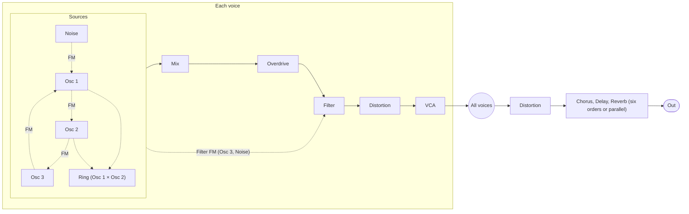

# Crest

Crest is an 8-voice hybrid polysynth for [Ableton Move](https://www.ableton.com/move/), running
as a sound-generator module in [Schwung](https://github.com/charlesvestal/schwung). Three
band-limited oscillators with wavetables and FM, a saturating multimode filter, three envelopes,
four LFOs, a 20-slot modulation matrix, eight macros, an arpeggiator and a Distortion, Chorus,
Delay and Reverb chain, all playable from Move's knobs and pads.

- **Play it in your browser:** <https://klaine.github.io/crest/> (the same DSP compiled to
  WebAssembly, with WebMIDI)
- **Download for Move:** [latest release](https://github.com/klaine/crest/releases/latest)
- **Every page and knob:** [plan/11-parameter-reference.md](plan/11-parameter-reference.md)
- **The spec and what is built:** [plan/README.md](plan/README.md) and
  [plan/17-implementation-status.md](plan/17-implementation-status.md)
- **What changed:** [release notes](https://github.com/klaine/crest/releases)

Crest is inspired by classic hybrid polysynths. It is not affiliated with any synth maker, and
its wavetables, arpeggiator rhythms and factory patches are its own. It can convert Novation Peak
SysEx banks that you have (see [Patches](#patches)), but it ships none, and no Peak patch is in
this repository; see [Third-party preset banks](#third-party-preset-banks).

## Installing on Move

Crest needs a Move with [Schwung](https://github.com/charlesvestal/schwung) installed.

1. Download `crest-module.tar.gz` from the
   [latest release](https://github.com/klaine/crest/releases/latest).
2. Install it with Schwung Manager, or by hand: extract the archive so that it lands at
   `/data/UserData/schwung/modules/sound_generators/crest/` on the Move.
3. Rescan modules in Schwung Manager, or restart Schwung.

Crest then appears under Sound Generators as **CRST**.

Developers with SSH access (add a key at `http://move.local/development/ssh`) can install a local
build with `scripts/deploy.sh [host]`. It stages the package on the Move's data partition and
renames it into place, so a running Schwung is not disturbed. `scripts/logs.sh` follows Schwung's
debug log.

## How it works

The signal path is one voice of a classic hybrid polysynth, eight times over:



Everything below is reachable from Move's parameter pages, and all of it from the Remote UI.

### Oscillators

Each of the three oscillators plays **Sine**, **Tri**, **Saw** or **Pulse** with a **Shape**
control, or one of **75 wavetables** (17 original tables plus 58 more, all designed for Crest).
The classic waves are anti-aliased with polyBLEP. Each oscillator also has **density** stacks of
detuned copies, **virtual sync**, a fixed-note mode, and coarse and fine tuning.

**FM** runs Osc 1 into Osc 2, Osc 2 into Osc 3, Osc 3 into Osc 1 and noise into Osc 1 as phase
modulation, and Osc 3 and noise can modulate the cutoff.

### Mixer, filter and drive

The mixer blends the three oscillators, a ring modulator and coloured noise, into an
**overdrive** before the filter. The **filter** has LP24, LP12, BP12, BP6, HP24 and HP12 modes,
resonance up to self-oscillation and drive inside its loop, and follows key, velocity and Mod
Envelope 1. A per-voice **distortion** comes after it.

### Envelopes and modulation

- **Three envelopes** (Amp, Mod 1 and Mod 2), each with a delay stage, repeats, and legato or
  retrigger modes.
- **Four LFOs**: LFO 1 and 2 run per voice with Low and High ranges, LFO 3 and 4 are global.
  Eight shapes, tempo sync, repeats, four fade modes (fade in or out, gate in or out), slew, and
  a common mode that keeps every voice in step.
- **Modulation matrix** of 20 slots, from 32 sources (the envelopes and LFOs, velocity, key,
  random, wheel, aftertouch, breath, expression, sustain, bend, the macros, Animate) to 59
  destinations.
- **Eight macros**, each driving its own destinations, and **Animate 1 and 2**, switches that bring
  in modulation for performance (MIDI CC 80 and 81 can hold or latch them).

### Effects

A global stereo chain. Distortion comes first, then chorus, delay and reverb in any of six
orders, or in parallel:

| Effect | Types |
|---|---|
| Distortion | Soft, Hard, Fold, Crush |
| Chorus | Chorus 1, Chorus 2, Ensemble |
| Delay | Stereo, Ping-Pong, Mono, free or synced to the tempo |
| Reverb | Room, Hall, Plate |

### Voices and playing

Eight voices in Poly, Poly2, Mono, MonoLG or Mono2 mode, unison up to eight voices per note with
detune and spread, glide, and per-voice **divergence** and analog **drift**. Crest responds to
velocity, pitch bend, channel and polyphonic aftertouch, the mod wheel, breath, expression and
the sustain pedal.

### Arpeggiator

Clocked from Move's tempo: seven modes (Up, Down, UpDown, UpDown2, Played, Random, Chord), 19
rates, 33 rhythms, one to six octaves, gate, swing, latch and key sync. **Scale** locks the held
keys to a scale: Set follows the Move set's root and scale, or pick a fixed one.

### Patches

Crest has 11 factory patches: Init Saw and ten more. Each has a category (Bass, Lead, Pad, Keys,
Poly, Bell, Strings, Arp, Movement, SFX and more), and the browsers on Move and in the Remote UI
step through one category at a time.

You can also load **Novation Peak banks you have** (`.syx` files, such as the ones Novation
offers at <https://components.novationmusic.com/peak/banks/>). Crest converts each patch with the
rules in [plan/18](plan/18-peak-import.md), gives it a category, and levels its loudness in the
background:

- **On Move:** copy the `.syx` files to `/data/UserData/UserLibrary/Crest` (subfolders are fine),
  then on the **Peak Banks** page pick a file with Peak Bank and a patch with Peak Patch.

  ```bash
  ssh -4 move.local 'mkdir -p /data/UserData/UserLibrary/Crest'
  scp -4 *.syx move.local:/data/UserData/UserLibrary/Crest/
  ```

- **In the browser:** Patches → **Load Peak .syx…**. The bank stays in the browser's storage.

## On Move

Crest opens on a home page that draws the patch name, the filter response and the amp envelope.
Its parameter pages, in order: Factory Patches (it steps through the category that the next page,
Patch Category, picks), Patch Category, Perform, Macros, Oscillator 1 to 3 (each with a
Modulation page), Mixer, Filter, Amp Envelope, Mod Envelope 1 and 2, Envelope Delays, LFO 1 and 2
(each with a Fade page), LFO 3, LFO 4, Mod Matrix, Matrix Slot, Macro Routing, Macro Edit, FM and
Filter FM, Voice Character, Arpeggiator, Voice, FX Routing, Distortion, Chorus, Delay, Reverb and
Peak Banks. A knob you hold shows a card with its value in real units (ms, Hz, semitones, note
names) and a picture where it helps. [plan/11](plan/11-parameter-reference.md) lists every
parameter with its range and default.

Patches are saved and automated through Schwung like any other module. The **Remote UI**, served
by Schwung in a browser, shows every parameter on one hardware-style panel, including the ones
Move's pages have no room for, with the patch on a drawn screen, the full modulation matrix and
macro routing, undo and redo, saving a patch to a file and loading it back, and a patch browser
with categories, banks, favourites and search.

## Playing in the browser

<https://klaine.github.io/crest/> is the whole synth as a single page: the Remote UI plus the
same DSP compiled to WebAssembly. Click **Start Crest**, then play from a WebMIDI device (Chrome
or Edge), from the computer keyboard (the A row plays the white keys, W E T Y U O P the black ones, Z
and X shift octaves), or from the on-screen keyboard with its velocity slider and mod wheel and
pitch bend strips. Your patch and any banks you load are kept in the browser.

## Building from source

Requirements: [zig](https://ziglang.org/) (`brew install zig`), the only C compiler the build
uses, and Python 3.

```bash
scripts/build.sh
```

This runs the generator check, the contract, UI and about 10,500 native tests, then writes
`modules/sound_generators/crest/dsp.so`, `crest-module.tar.gz` and `build/crest.html`.

Other targets:

```bash
scripts/build.sh --gen                   # regenerate first, after editing tools/gen/params.py or presets
scripts/build.sh --render                # also one WAV per factory patch in build/demo
scripts/build.sh --bench                 # also a native CPU benchmark
scripts/build.sh --profile               # dsp.so with a read-only cpu_us key (render time)
scripts/build.sh --release               # a package to publish (below)
scripts/build_web.sh                     # browser build in build/site; serve it with python3 -m http.server -d build/site 8765
scripts/deploy.sh [host]                 # install the build on a Move over SSH
CREST_BLEP_POINTS=4 scripts/build.sh     # 4-point polyBLEP variant
```

`build/crest.html` is the browser synth as one file (about 7 MB) that opens from disk, the same
page that GitHub Pages serves. It only ever holds the Crest patches, and loading your own banks
still works in it. `node tests/device/test_device_ui.mjs --png build/device_preview` renders the
on-device pages and cards as PNGs.

`tools/gen/params.py` defines every parameter and Move page, and `gen.py` writes the C tables,
contract and factory bank from it; the build fails if any of them is stale. A package to publish
is built with `scripts/build.sh --release`, which leaves local Peak banks out and then checks the
tarball: only the Crest patches, no Peak patch name in any file (`dsp.so` included), no build
paths and no macOS metadata. Run `scripts/build.sh` afterwards to get your own package back. See
[CONTRIBUTING.md](CONTRIBUTING.md) before opening a pull request.

### Building Peak banks into your own build

Put the `.syx` files in `reference_novation/` and run the pipeline in
[plan/18](plan/18-peak-import.md#pipeline): `tools/peak/import_banks.py`, the loudness pass
`tools/peak/level.py`, `tools/gen/gen.py`, then `scripts/build.sh`. The converted banks land in
`presets/peak/`, and `gen.py` writes bank sources that include them to `build/peak/`, which the
build compiles into your `dsp.so`, package and `build/site` in place of the committed Crest-only
ones. `tests/peak/test_import.py` checks the counts of the author's set (8 banks, 529 unique
patches), so update those numbers when you import other banks.

### Third-party preset banks

Novation's factory banks and the community banks have their own authors, and their
redistribution rights are unclear. `reference_novation/`, `presets/peak/` and `build/peak/` stay
local and git-ignored (the Peak import tests skip without them). A package built with them is for
your own Move: get the authors' consent before sharing it, or build it with `--release`.

## Status

Crest is a beta. It runs on Move, Peak bank loading included. Known gaps:

- Only 11 factory patches so far. A curated set of 64 is planned.
- No reverb freeze.
- Move's parameter list is full, so a few parameters are in the Remote UI only: LFO fade sync,
  LFO 3 and 4 repeats and fade mode, delay slew, ratio and width, chorus and reverb EQ, and reverb
  modulation.
- Not every on-device page and card has been checked on hardware one by one; see
  [plan/17](plan/17-implementation-status.md).

Bug reports and ideas are welcome as [issues](https://github.com/klaine/crest/issues).

## Project layout

| Path | Contents |
|---|---|
| `src/dsp/` | The plugin: `crest.c` (entry, MIDI, render), `voice.c`, `osc.c`, `filter.c`, `env.c`, `fx.c`, `params.c`, the Peak converter and bank loader (`*_gen.*` are generated) |
| `src/module.json`, `help.json`, `cards.js`, `canvas.js` | Manifest and on-device UI: knob cards and drawn pages |
| `src/web_ui.html`, `src/web/` | Remote UI, also the standalone browser synth's UI |
| `web/` | Browser build: WebAssembly host, AudioWorklet, Peak import worker, single-file loader |
| `tools/gen/` | `params.py` (every parameter, enum and Move page) and `gen.py` |
| `tools/peak/` | Peak SysEx converter and loudness pass |
| `presets/factory/` | Factory patches as JSON (only the keys that differ from Init) |
| `presets/peak/` | Patches converted from your Peak banks (local, not committed) |
| `tests/` | Contract validator, native tests, benchmark, WAV renderer, Peak import, device and web UI tests |
| `scripts/` | Build, release check, deploy, Pages |
| `plan/` | Specification, status and roadmap (start with [plan/README.md](plan/README.md)) |

The module does no file I/O and no heap allocation on the audio thread; Peak banks load on a
worker thread.

## License

MIT, see [LICENSE](LICENSE). The effects are adapted from Amino (MIT), by the same author.
Schwung's API header and set-info reader are MIT too; see
[THIRD_PARTY_NOTICES.md](THIRD_PARTY_NOTICES.md). Schwung and Ableton Move are separate projects
under their own licenses.
